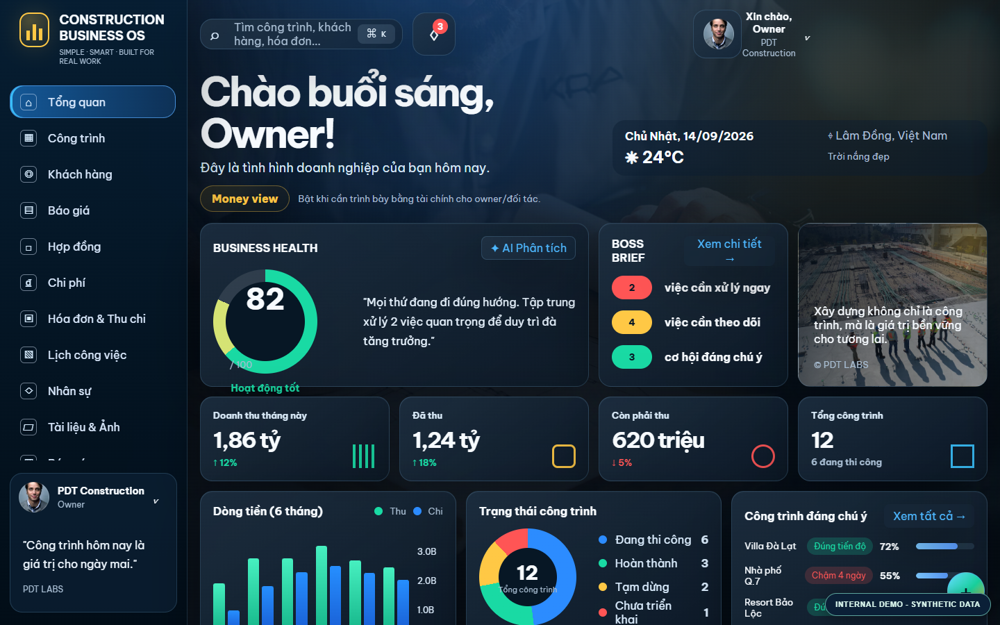
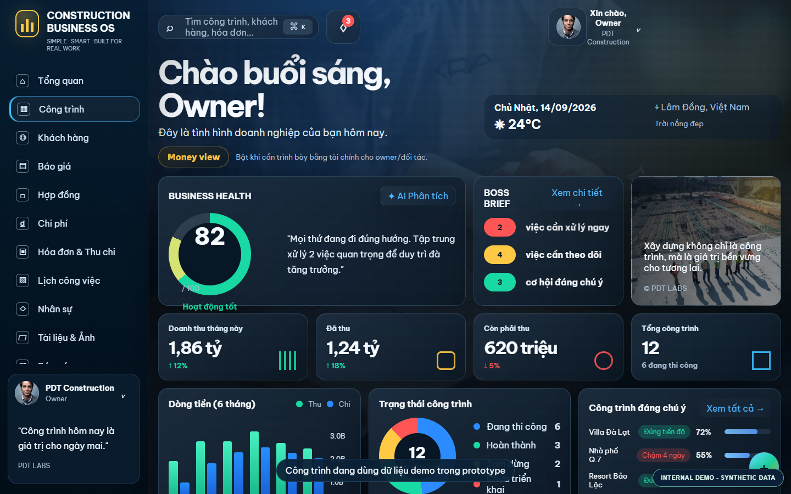
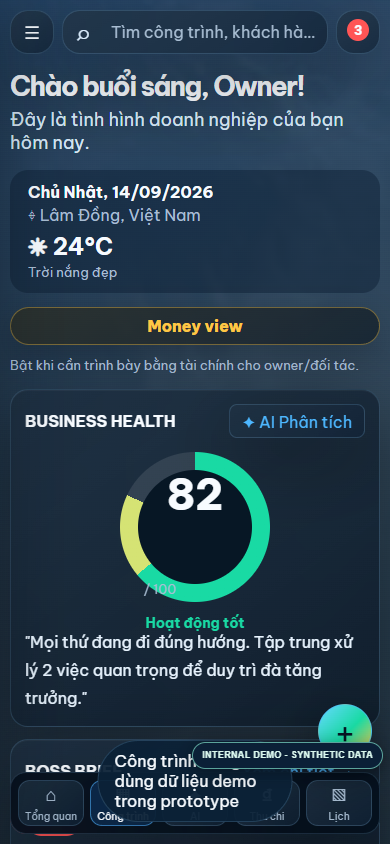

# PDT Construction Command Center — UI Prototype

A responsive construction-operations command center, built with **HTML, CSS, and JavaScript**. Curated as an isolated portfolio project from PDT LABS' private Construction Business OS work.

> **Disclosure:** Self-initiated demo. All projects, companies, amounts, task records and alerts shown are synthetic illustrative data. No real customer, paying client, project delivery, financial benefit or production deployment is claimed.

## Screenshots



| Projects view | Mobile dashboard |
| --- | --- |
|  |  |

## What this demonstrates

- Owner-focused overview of project health, cash flow, risks and priorities
- Navigation across jobs, quotes, contracts, expenses and financial summaries
- Desktop/mobile responsive design and user interactions
- Synthetic data adapter in `data.js`
- Clean standalone web demo without live APIs or production credentials

## Run locally

No build tools required.

```sh
python -m http.server 8080
```

Then open http://localhost:8080. Alternatively serve the folder with any static HTTP server.

## Basic verification

```sh
node --check app.js
node --check data.js
node tests/check-sample.mjs
```

Automated checks are for syntax and curated demo boundaries, not a substitute for complete E2E/security testing.

## Boundaries and attribution

- Source curated from the **PDT LABS-owned private Construction Business OS repository**. Original private repo remains unchanged.
- No database, authentication, active payment flow, backend AI or customer integration is provided.
- Interactive controls may simulate actions and use local browser storage.
- **No open-source license is granted for reusing this application's code.** Third-party fonts remain under their own upstream terms.
